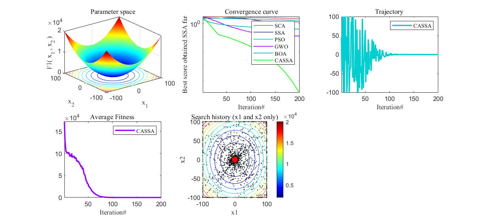
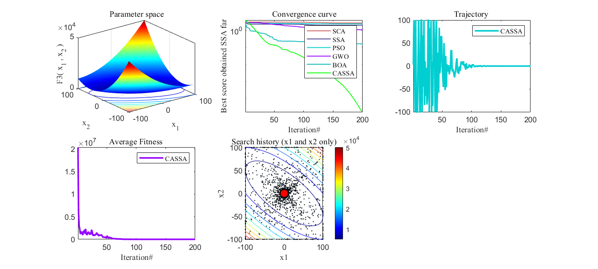
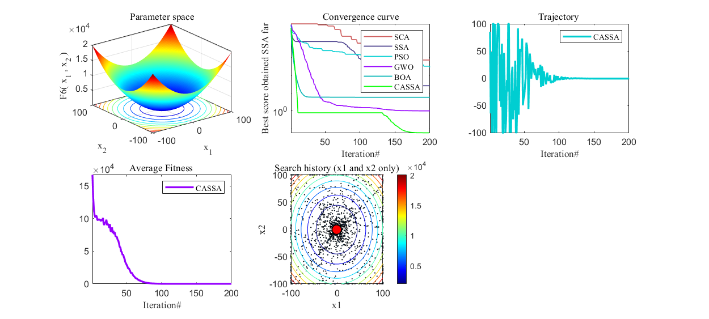
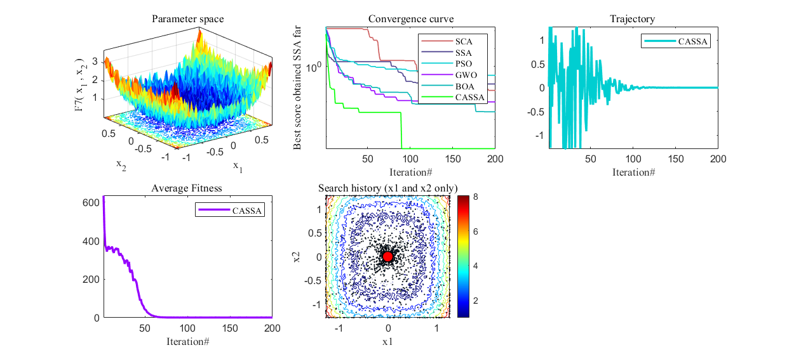
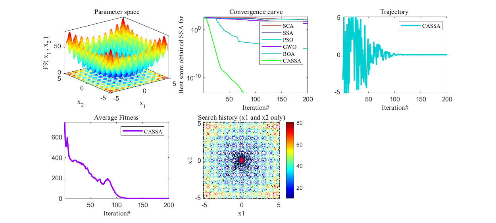
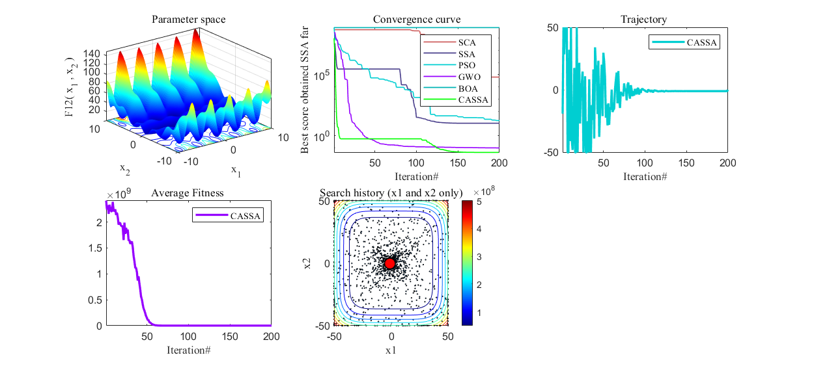
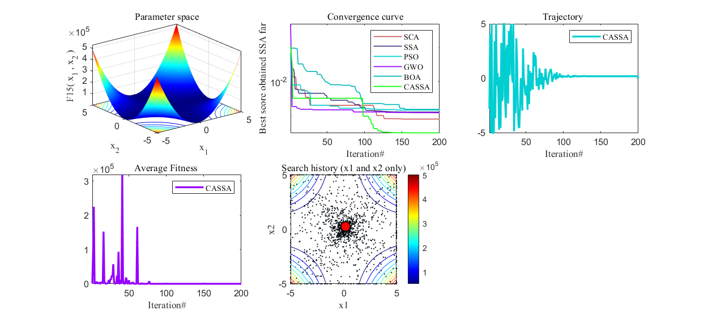
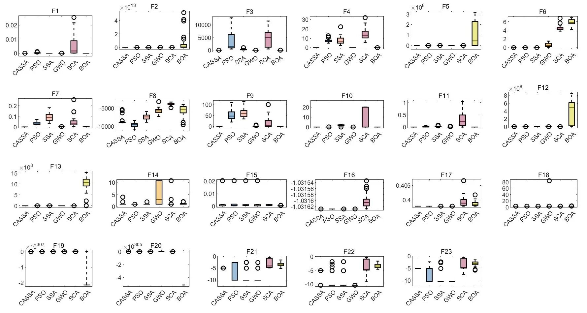
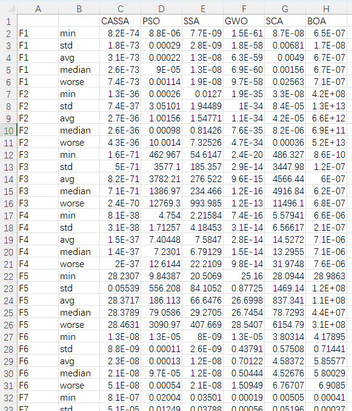
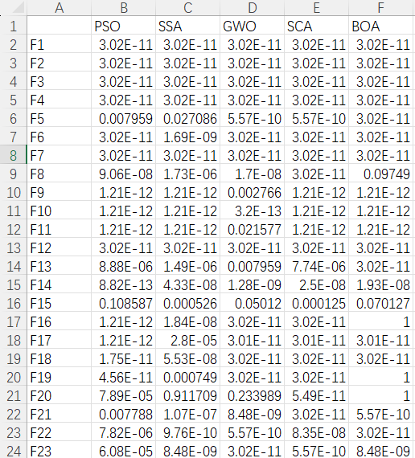

# Adaptive Squid Algorithm Based on Crazy Adaptation, Reproducing the Algorithm, MATLAB Code

This article reproduces a highly cited paper from CNKI titled "A Canoe Squid Algorithm Based on Crazy Adaptive". The reference is as follows:
[1] Zhang Damin, Chen Zhongyun, Xin Ziyun et al. A Canoe Squid Algorithm Based on Crazy Adaptive [J]. Control and Decision, 2020, 35(09):2112-2120.
The abstract of the article is as follows:
To address the shortcomings of the canoe squid algorithm in terms of low precision and slow convergence speed, this paper proposes a canoe squid algorithm based on crazy adaptive. By introducing a tent chaotic sequence to generate initial populations, diversity among individuals is increased; a crazy operator is introduced at the food source position to enhance population diversity; an adaptive inertia weight is introduced into the follower position update formula to better balance global and local search capabilities of the algorithm.
Since its introduction, the canoe squid algorithm has been improved by many scholars and applied in engineering practice. The original version of the canoe squid algorithm has been cited over 3800 times, demonstrating its superiority. The basic principle of the canoe squid optimization algorithm (SSA) can be referred to for detailed explanations and MATLAB code.
The principle of the canoe squid algorithm based on crazy adaptive is as follows:
Improvement strategy
Point 1: Tent map initialization of the population
The initialization of the canoe squid population is crucial for the convergence speed and optimization accuracy of the SSA algorithm. At the beginning of the canoe squid population, without any prior knowledge, most population-based algorithms use random initial positions.
The tent map can generate better uniform sequences than the logistic map. In this paper, we use the tent map to generate chaos sequences for initializing the canoe squid population algorithm, with the mathematical expression as follows:
Where: μ ∈ (0, 2] is the chaos parameter, larger values of μ result in better chaos, and in this paper μ = 2; i = 1, 2, ..., N represents the population size; j = 1, 2, ..., d denotes the number of chaos variables.
Point 2: Crazy operator
In the swarming Salp algorithm, the position of the food source plays a crucial role in the population. It guides the group towards the optimal solution but can lead to premature convergence if the food source falls into local optima, resulting in a lack of diversity within the population. During movement, the food source cannot always remain stationary; it may suddenly change its position to increase unexpected behaviors in the population. This paper describes such behavior using the "crazy" factor, which is modeled through the crazy variable. To mitigate premature convergence in the SSA algorithm, an insane operator is introduced into the leader position update formula in the swarming Salp algorithm. This ensures that the swarm maintains diversity around the preset insane probability by causing some disturbance to the food source position. The new leader update formula is as follows:

Improvement point 3: Adaptive Inertia Weight
When the inertia weight is large, it enhances exploration capability; when it is small, it facilitates specific development. If the follower's position is a local optimum, it can easily fall into local optima and stop progressing. To better balance the swarming Salp algorithm's exploration and development capabilities, a linearly decreasing inertia weight is introduced, determining the degree of influence from previous individuals on the current individual. The new follower position formula is as follows:

For more principles introduction, please refer to the original document.
Results display
The original document was tested on the CEC2014 function set, but here we will use the classic CEC2005 function set for testing! We will also compare with the SCA (Sinusoidal Cosine Algorithm), PSO (Particle Swarm Optimization), GWO (Gray Wolf Optimization), BOA (Butterfly Optimization), and the original swarming Salp algorithm (SSA).
We will draw function images, iteration curves, historical trajectory graphs, average convergence graphs, and historical position graphs. These figures are often involved in many papers on intelligent algorithms.
Testing on CEC2005:
F1:
F3:
F6:
F7:
F9:
F12:
F15:
The above images, the code can be run to produce results.
CEC2005 indicator statistics are as follows:  
Each algorithm is iterated 500 times, the population size is set to 30, each function runs 30 times, and the optimal value, standard deviation, mean, worst value, median of five indicators are calculated. The rank sum test result and box plot are shown as follows.  
Box plot:  
After running, an excel sheet will automatically appear to count the results of five indicators:  
Rank sum test result:  
Code directory:

## Images

<!-- PAYMENT_BLOCK -->

## Get this dataset

- Payment link (Stripe): [Buy now](https://buy.stripe.com/3cs8yP7sY87d0vu9AB)
- Payment QR code: 

<!-- /PAYMENT_BLOCK -->
